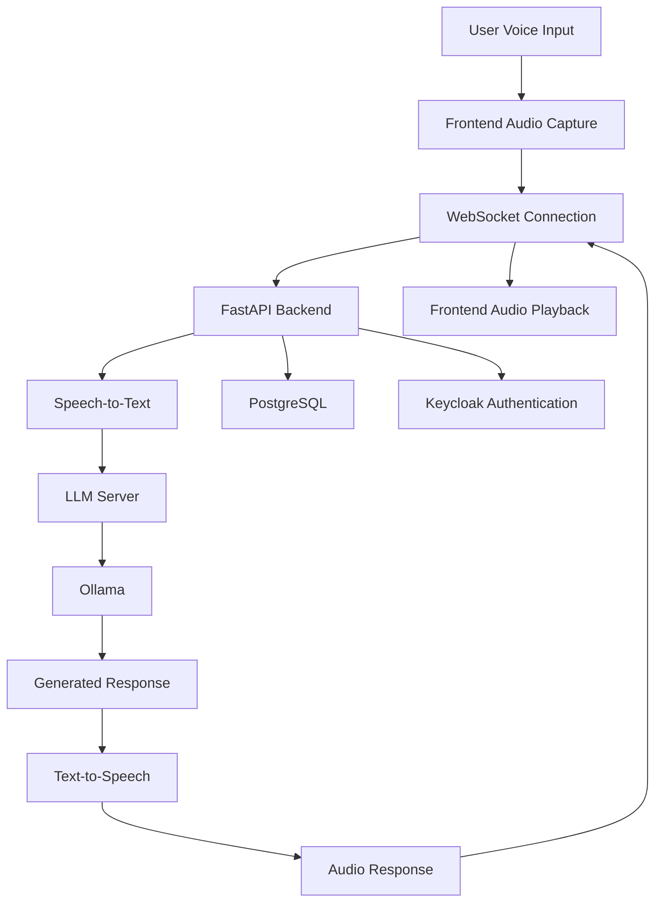

# AI-Powered Voice Bot - Onprime 

An AI-powered conversational voice assistant designed to interact with customers, answer queries, collect information, and support lead qualification for real estate sales. The system combines speech recognition, a locally hosted LLM, text-to-speech, and a web-based interface to enable natural voice conversations.

## Overview

This project demonstrates a voice-based AI assistant that processes user speech, generates context-aware responses using a language model, and converts those responses into audio. It is designed for conversational workflows such as real estate inquiries, customer engagement, and lead qualification.

## Key Features

- **Voice Interaction:** Captures audio from the frontend and processes spoken user queries.
- **Speech-to-Text (STT):** Converts incoming audio into text for language model processing.
- **LLM-Powered Responses:** Generates conversational responses using a locally hosted LLM through Ollama.
- **Text-to-Speech (TTS):** Converts generated responses into speech for playback.
- **Streaming Responses:** Streams generated text to the frontend over WebSockets.
- **Web-Based Interface:** Provides a frontend for interactive voice conversations.
- **Containerized Deployment:** Uses Docker Compose to orchestrate backend, frontend, database, authentication, and LLM services.
- **Authentication Infrastructure:** Integrates Keycloak for identity and access management.
- **Persistent Storage:** Uses PostgreSQL for relational data storage.

## Technology Stack

| Category | Technologies |
|---|---|
| Programming Language | Python |
| Backend Framework | FastAPI |
| Real-Time Communication | WebSockets |
| Speech-to-Text | Faster-Whisper |
| Large Language Model | Ollama |
| Text-to-Speech | gTTS, pyttsx3 |
| Audio Processing | NumPy, SoundDevice, PyAudio |
| Frontend | Web-based frontend, React-related tooling |
| Database | PostgreSQL |
| Authentication | Keycloak |
| Containerization | Docker, Docker Compose |
| LLM Serving | Custom LLM server integrated with Ollama |

## System Architecture



## How It Works

1. **Audio Capture:** The frontend captures user audio and streams audio chunks to the backend through a WebSocket connection.
2. **Speech Recognition:** The backend processes the audio and converts it into text using the speech recognition component.
3. **Language Model Processing:** The transcribed text is sent to the LLM server, which communicates with Ollama to generate a response.
4. **Response Streaming:** The generated response text is streamed back to the frontend.
5. **Speech Generation:** The response is converted into audio using the configured text-to-speech engine.
6. **Audio Playback:** The generated audio is sent to the frontend for playback, allowing the user to continue the conversation.

## Project Structure

The repository contains the following major components:

```text
Voice_bot_onprime/
├── frontend/                # Frontend application
├── multi_lingual/            # Multilingual-related components
├── app.py                    # FastAPI WebSocket voice application
├── app1.py                   # Additional application entry point
├── main.py                   # Voice processing entry point
├── main1.py                  # Additional processing entry point
├── auth_utils.py             # Authentication utilities
├── database_manager.py       # Database management
├── requirements.txt          # Python dependencies
├── backend.Dockerfile        # Backend container configuration
├── llm_server.Dockerfile     # LLM server container configuration
├── keycloak.Dockerfile       # Keycloak container configuration
├── docker-compose.yml        # Multi-service orchestration
├── ollama_init.sh            # Ollama initialization
├── ollamasetup.sh            # Ollama setup script
├── realm-export.json         # Keycloak realm configuration
└── implementationplan.md     # Implementation and setup notes
```

## Prerequisites

Install the following tools before running the project:

- Git
- Docker
- Docker Compose
- Sufficient RAM and disk space for the configured LLM
- A compatible browser with microphone access

## Getting Started

### 1. Clone the repository

```bash
git clone https://github.com/saidinesh98/Voice_bot_onprime.git
cd Voice_bot_onprime
```

### 2. Configure the application

Review the following files before starting the application:

- `docker-compose.yml`
- `backend.Dockerfile`
- `llm_server.Dockerfile`
- `keycloak.Dockerfile`
- `ollama_init.sh`
- `realm-export.json`

Verify database settings, model configuration, service URLs, ports, and authentication settings. Ensure the backend's LLM server URL points to the correct service address for your environment.

### 3. Start the services

Build and start the containers:

```bash
docker compose up --build
```

To run the services in the background:

```bash
docker compose up --build -d
```

### 4. Verify the services

The Compose configuration publishes the following ports by default:

| Service | Local URL / Port |
|---|---|
| Frontend | `http://localhost:3000` |
| FastAPI backend | `http://localhost:8001` |
| LLM server | `http://localhost:8000` |
| Ollama | `http://localhost:11434` |
| Keycloak | `http://localhost:8080` |
| PostgreSQL | `localhost:5432` |

Open the frontend in your browser and grant microphone access when prompted.

These are the configured service ports; successful access depends on the containers starting correctly and the application being configured for those endpoints.

### 5. Stop the services

```bash
docker compose down
```

To remove the persistent Compose volumes as well, use the following command only if you intend to delete the stored database and model data:

```bash
docker compose down -v
```

## Configuration and Security

- Do not commit passwords, API keys, or other sensitive configuration values to Git.
- Replace default database and authentication credentials before deploying outside local development.
- Restrict CORS origins instead of allowing all origins in production.
- Keep the LLM server and database accessible only to authorized services.
- Configure HTTPS and appropriate authentication before exposing the application publicly.
- If using a tunnel for remote testing, expose only the endpoints required by the application.

## Potential Applications

- Real estate inquiry handling
- Customer engagement and lead qualification
- Property information assistance
- Conversational information collection
- Voice-based customer support

## Future Enhancements

- Integrate outbound calling through a telephony provider.
- Capture and persist qualified leads with customer consent.
- Add multilingual speech recognition and synthesis.
- Integrate a CRM or sales management platform.
- Add conversation analytics, lead summaries, and operational monitoring.

## License

Add the applicable license information before distributing or publishing this project.
